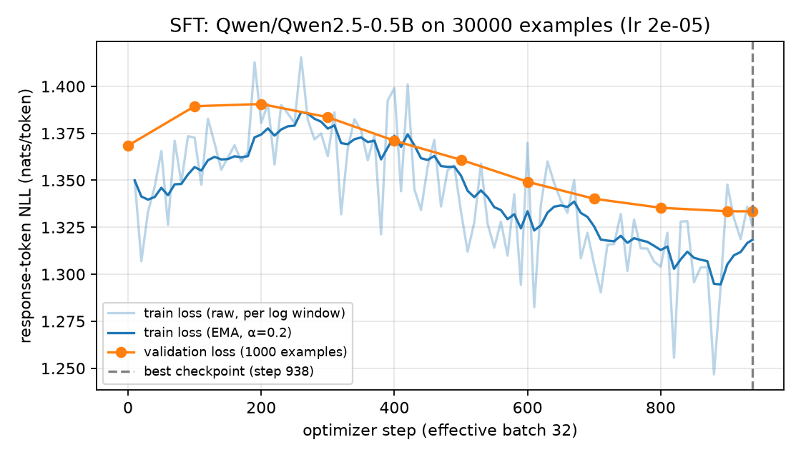
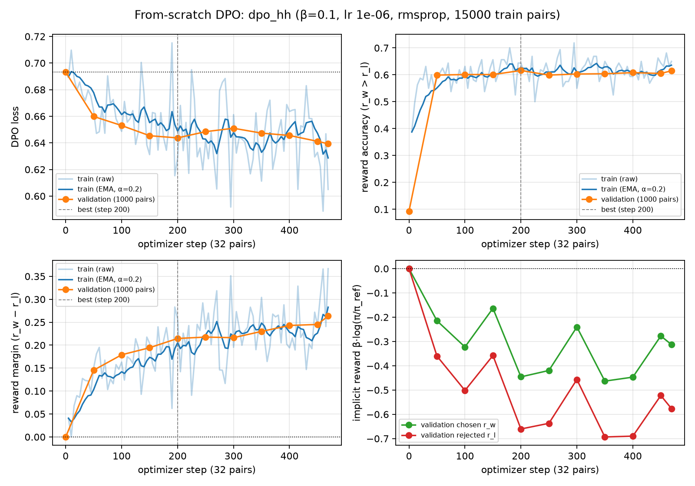
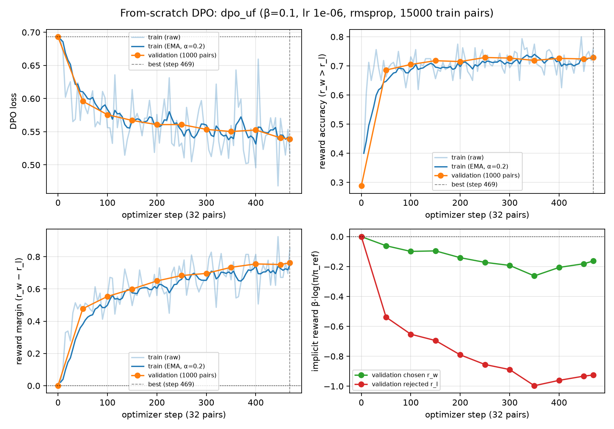
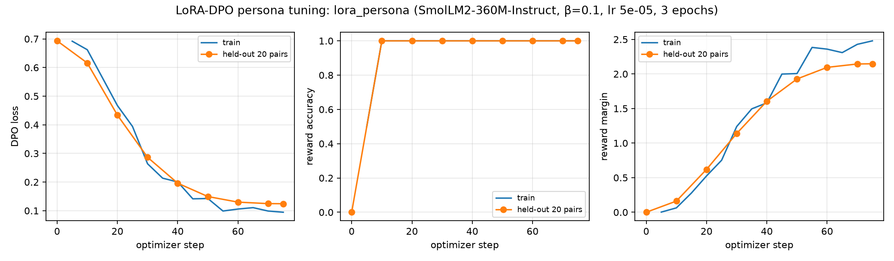

# Instruction Tuning and Direct Preference Optimization on a Small Language Model

**Name:** [FILL] · **Roll number:** [FILL] · **Course:** CS 5326 · **Repository:** [FILL: https://github.com/<user>/small-model-alignment]

> How to use this template: every `[FILL]` must be replaced with a number or observation from YOUR runs. The tables marked
> *auto* are produced by `python scripts/collect_results.py --runs_root outputs` (notebook 06 writes them to
> `outputs/report_tables.md`); paste them in. Delete this note and keep the PDF to **≤ 8 pages** including figures and references.

## 1. Repository, models, and data (§14.1)

**Base checkpoints.** `Qwen/Qwen2.5-0.5B` for SFT and both from-scratch DPO runs; `HuggingFaceTB/SmolLM2-360M-Instruct` for the LoRA persona run.

| Track | Source | Train | Validation | Evaluation set |
|---|---|---|---|---|
| SFT | `HuggingFaceH4/ultrachat_200k` (train_sft / test_sft), first user turn + first reply | 30,000 | 1,000 | – |
| HH-RLHF DPO | `Anthropic/hh-rlhf` (train / test), single-turn pairs | 15,000 | 1,000 | `eval_sets/hh_rlhf_eval_300_seed42.json` (300, 10 categories) |
| UltraFeedback DPO | `HuggingFaceH4/ultrafeedback_binarized` (train_prefs / test_prefs) | 15,000 | 1,000 | `eval_sets/alpaca_eval_300_seed42.json` (300 of 805, seed 42) |
| LoRA persona DPO | `data/persona_lora/ramsay_style_preferences.json` | 200 | 20 | `eval_sets/persona_style_eval.json` (24: cooking/coding/general/safety) |

**Seeds.** 42 for data shuffling, subset selection, the AlpacaEval subset, training, and A/B order randomization.

**Filtering** (counts in `data/processed/manifest.json`). Single-turn only. Empty or identical responses removed. UltraFeedback score ties removed. Formatted prompt ≤ 256 tokens. SFT keeps only complete demonstrations (prompt + response + EOS ≤ 512) so the model always sees where a response ends. DPO pairs whose chosen and rejected windows become identical after truncation are removed. Exact-match overlap with any evaluation prompt is removed. [FILL: kept / seen counts from the manifest]

**Prompt format** (identical for SFT, DPO and all Qwen generations):
```
### Instruction:\n{instruction}\n\n### Response:\n{response}<|endoftext|>
```
A plain template was chosen because the base model has no chat tuning. The appended EOS (`<|endoftext|>`) is exactly the token the adapter contract appends. SmolLM2 uses its own ChatML chat template, applied by TRL and by `generate.py --prompt_format chat`.

## 2. Experimental configuration (§14.2)

[PASTE *auto* table "Experimental configuration" from `outputs/report_tables.md`]

**Generation settings** (all comparisons): greedy decoding (no temperature, no top-p), `max_new_tokens=512`, `repetition_penalty=1.1`, no n-gram constraint, fp32 weights, stop on EOS or on the string `### Instruction:`. Identical for every model within a comparison; per-file settings are in `outputs/generations/*.meta.json`. [PASTE *auto* generation-settings table]

**Implementation notes.**
- **SFT loss reduction:** the mean over all unmasked response tokens in the effective batch. The normaliser is the response-token count across all 16 accumulated micro-batches, so every token in an optimizer step has equal weight.
- **Precision:** fp16 autocast with fp32 master weights and a GradScaler. T4s do not support bf16.
- **DPO reference:** loaded in fp32 under the same autocast, so step-0 policy and reference log-probs are identical (loss = ln 2, reward accuracy = 0). Log-probs are summed over response tokens only, in fp32.
- **Exact reference checkpoint:** for both DPO runs, the policy init and the frozen reference are the SFT *best* checkpoint, step [FILL from `reference_checkpoint_state` in `outputs/dpo_*/summary.json`], validation loss [FILL].

**LoRA configuration justification (Task 5, required by §11).**
- **Rank r=16, α=32 (scale 2).** Large enough to express a consistent style shift across topics, while training only ~2% of parameters. [FILL: exact trainable count from `outputs/lora_persona/summary.json`]
- **Target modules: all attention and MLP projections.** Style lives in both *what* tokens are attended to and *how* they are transformed; attention-only LoRA tends to under-fit tone.
- **Learning rate 5e-5, cosine schedule, 10% warmup.** LoRA's B matrix starts at zero, so it needs a much larger LR than the 1e-6 used for full-parameter DPO.
- **Effective batch 8, 3 epochs (~75 steps).** With only 200 training pairs, one epoch is ~25 steps; three epochs give enough updates, while held-out reward accuracy is watched for overfitting.
- **Dropout 0.05.** Regularisation for the tiny dataset.
- **Reference model.** With `ref_model=None` and a PEFT config, TRL uses the base model with the adapter disabled.
- **Other.** β=0.1; fp16 AMP with fp32 weights.
- [FILL: anything you changed after looking at the curves/outputs, with the evidence]

## 3. Parameter choices and deviations (§14.3)

| Item | Guide value | Final value | Type | Reason / evidence |
|---|---|---|---|---|
| Reference precision | fp16 allowed | fp32 + fp16 autocast | numerical | exact policy/reference parity at step 0; GPU1 has ample memory [FILL: confirm step-0 val acc = 0.000] |
| DPO optimizer | RMSprop or AdamW | RMSprop | choice within guide | matches the DPO paper's setup; one state tensor per parameter (less memory than AdamW) |
| SFT data filter | not specified | complete examples ≤ 512 tokens | data | avoids training on truncated responses that never show an EOS [FILL: effect on stopping behaviour, e.g. % outputs hitting max tokens] |
| Weight decay scope | 0.1 | 0.1 on ≥2-D weights only | standard practice | biases and norm gains are not decayed |
| Decoding | greedy | greedy + repetition_penalty 1.1 | decoding | [FILL: sanity check showed loops without it / or remove if not needed] |
| transformers | ≥4.43,<5 | ≥4.56.2,<5 | resource / compatibility | required by TRL 0.29 for the LoRA task; same version used everywhere |
| [FILL any other change, e.g. batch size for OOM] | | | resource / performance | |

## 4. Training behaviour (§14.4)






[PASTE *auto* table "Training outcomes"]

[FILL, 4-6 sentences]
- SFT: did validation loss fall smoothly from the step-0 base value of [FILL] to [FILL]? Is there any train/val gap?
- DPO: describe the reward-accuracy rise from exactly 0 at step 0, and the margin. Did chosen and rejected rewards both fall (a known DPO behaviour)? Which step was selected, and is that step the final one or earlier?
- LoRA: did reward accuracy saturate on 20 held-out pairs, which would suggest overfitting a tiny dataset?
- Do not infer response quality from these curves.

## 5. DPO-versus-SFT results (§14.5)

Judge: [FILL: model actually used] via `kaggle_benchmarks`. Batches of 5 pairs, ≥5 s between attempts, up to 3 attempts per batch. Responses are labelled only "Response A/B", in a random order (seed 42). The HH rubric additionally rewards appropriate refusal, privacy protection, calibrated uncertainty and safe redirection. Unknown or failed judgments are excluded from win rates and reported separately.

[PASTE *auto* pairwise table. Keep UF-DPO (AlpacaEval) and HH-DPO (HH set) as separate rows. Do not combine them.]

**Position-bias check.** [FILL: consistency on 100 A/B-swapped pairs per track, and the "judge picked A" rate]

**LoRA persona (separate target).** Style rubric: LoRA vs base [FILL W/T/L]. Quality/safety rubric (style ignored): [FILL W/T/L]. [FILL: one sentence on whether style improved without losing usefulness or safety, citing the safety-sensitive prompts]

## 6. Interpretation and error analysis (§14.6)

[FILL; separate *measured* from *interpretation*]
- **Which model won on each set, and by how much** (win rate, with and without ties).
- **Per-category breakdown** on the HH set ([PASTE per-category table]). Is the gain concentrated in refusal categories? Is there over-refusal on `benign_helpfulness` (alignment tax)? Use the `refusal_phrase_rate_by_category` values from `outputs/eval/generation_stats.json`.
- **Verbosity.** Mean words for SFT vs DPO (generation stats). Does the judge's preference track length?
- **Link to diagnostics.** Relate the results to reward accuracy, margin, β = 0.1, lr 1e-6 and about 469 steps. Small movement from the reference may explain small win-rate changes.
- **Examples** from `outputs/eval/examples_*.md`. Give 1-2 where DPO improves and 1-2 where it regresses or barely changes. Quote briefly and tie each to the aggregate numbers.

## 7. Limitations and reproducibility (§14.7)

**Limitations.**
- A single seed per run.
- Only 300 prompts per evaluation set (±[FILL] binomial standard error on the win rate).
- One LLM judge, with possible position, length and self-preference biases.
- One epoch per run, and only 24 persona prompts.
- [FILL: any failed runs or Kaggle interruptions]

**Where everything lives.**
- Configs: `configs/*.yaml`. Actual values: `outputs/<run>/config_used.json`.
- Metrics: `outputs/<run>/metrics.jsonl` and `summary.json`.
- Generations: `outputs/generations/*.json` (+ `.meta.json`).
- Pairs and judgments: `outputs/eval/*_pairs.jsonl`, `*_judged.jsonl`, `*_summary.json`, `*_failures.jsonl`.
- Tables: `outputs/report_tables.md`.

**Reproduce.** Run notebooks `01` → `02` → `03a`/`03b` → `04` → `05` → `06` in `notebooks/`. Offline tests: `PYTHONPATH=. python -m pytest -q tests/`.

## Works Cited

Bai, Yuntao, et al. "Training a Helpful and Harmless Assistant with Reinforcement Learning from Human Feedback." *arXiv*, 2022, arXiv:2204.05862.

Cui, Ganqu, et al. "UltraFeedback: Boosting Language Models with Scaled AI Feedback." *Proceedings of the 41st International Conference on Machine Learning*, 2024.

Ding, Ning, et al. "Enhancing Chat Language Models by Scaling High-Quality Instructional Conversations." *Proceedings of the 2023 Conference on Empirical Methods in Natural Language Processing*, 2023.

Dubois, Yann, et al. "Length-Controlled AlpacaEval: A Simple Way to Debias Automatic Evaluators." *arXiv*, 2024, arXiv:2404.04475.

Hu, Edward J., et al. "LoRA: Low-Rank Adaptation of Large Language Models." *International Conference on Learning Representations*, 2022.

Ouyang, Long, et al. "Training Language Models to Follow Instructions with Human Feedback." *Advances in Neural Information Processing Systems*, vol. 35, 2022.

Qwen Team. "Qwen2.5 Technical Report." *arXiv*, 2024, arXiv:2412.15115.

Rafailov, Rafael, et al. "Direct Preference Optimization: Your Language Model Is Secretly a Reward Model." *Advances in Neural Information Processing Systems*, vol. 36, 2023.

von Werra, Leandro, et al. *TRL: Transformer Reinforcement Learning*. GitHub, 2020, github.com/huggingface/trl.

Wolf, Thomas, et al. "Transformers: State-of-the-Art Natural Language Processing." *Proceedings of the 2020 Conference on Empirical Methods in Natural Language Processing: System Demonstrations*, 2020, pp. 38-45.

Zheng, Lianmin, et al. "Judging LLM-as-a-Judge with MT-Bench and Chatbot Arena." *Advances in Neural Information Processing Systems*, vol. 36, 2023.
